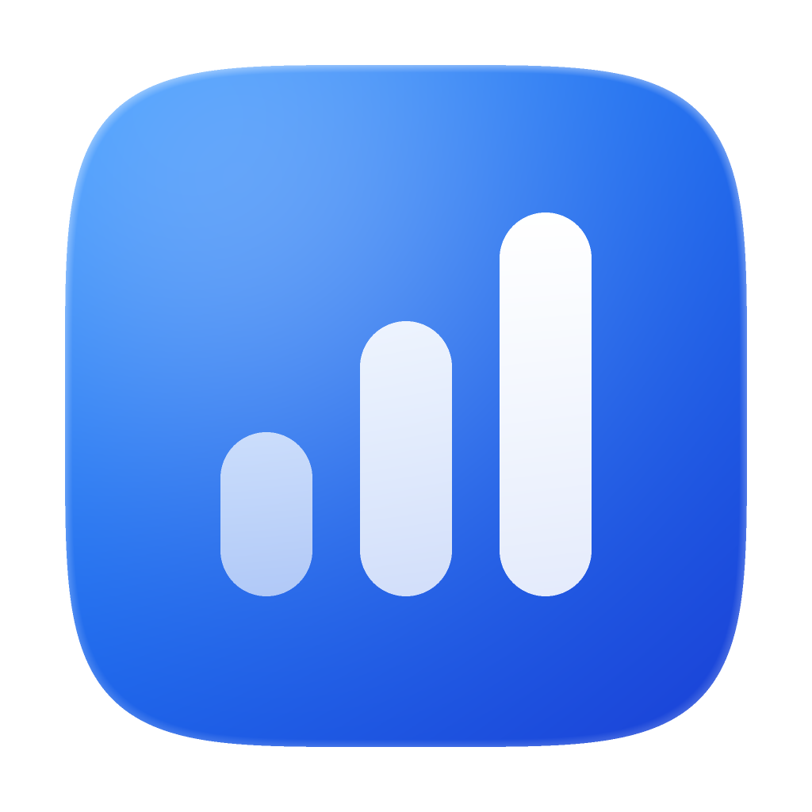
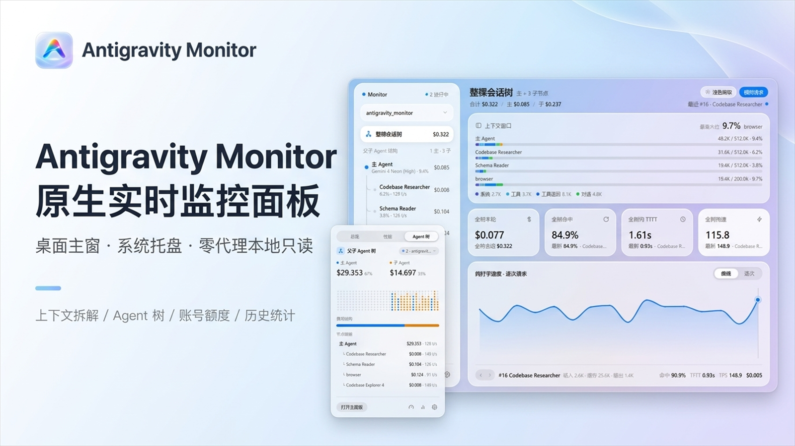

<div align="center">



# Antigravity Monitor

**面向 Antigravity 的原生上下文与 Token 实时监控面板**

桌面主窗口 · 系统托盘弹层 — 零代理、零 WebView、纯本地只读

上下文成分拆解 · 父子 Agent 拓扑 · 账号实时额度 · 历史消耗统计

[](https://github.com/oysterhyd/antigravity-monitor/releases/latest)
[](https://github.com/oysterhyd/antigravity-monitor/releases/latest)
[](https://github.com/egoist/mygo)
[](#核心功能)
[](LICENSE)
[](https://linux.do)

[下载安装](#下载安装) · [核心功能](#核心功能) · [使用说明](#使用说明) · [隐私与架构](#隐私与架构) · [从源码构建](#从源码构建) · [更新日志](CHANGELOG.md) · [开源协议](#开源协议)

<br />



</div>

---

## 核心功能

### 双形态原生体验
- **桌面主窗口**：Apple Liquid Glass 极简视觉与响应式大屏适配，支持浅色 / 深色跟随系统及中文 / English 实时切换。
- **系统托盘弹层**：轻点托盘图标即刻呼出毛玻璃弹层，内置实时概览、速率与缓存、父子 Agent 树、账号实时额度与历史消耗统计，无需切出当前工作窗口即可一目了然。

### 上下文窗口多色拆解
- 直接解析本地精确遥测字段，按 **系统 / 工具 / 工具返回 / 对话 / 摘要** 五类成分呈现多色进度条，支持分段悬停高亮查看 Token 数与窗口占比。
- 支持上下文 80% 预警提醒，快速定位窗口膨胀来源。

### 父子 Agent 可视化拓扑
- 清晰呈现主 Agent 与全部 Subagent 的层级结构与实时运行状态，自动区分「整棵会话树汇总」与「单节点独立视图」。
- 支持多对话并行自动跟随与手动锁定，点击托盘节点可直接联动主窗口聚焦。

### 全维度实时遥测
- 实时统计 **本轮 / 会话费用**、**Prompt 缓存命中率**、**首字时长（TTFT）** 与 **纯吐字速度（Pure Decode TPS）**。
- 底部支持平滑曲线与逐次请求明细双视图，支持键盘方向键与鼠标悬停逐点回看单次请求的输入、缓存、输出与费用构成。

### 账号实时额度与双趋势线
- 自动读取 **Gemini Models** 与 **Claude & GPT Models** 的 5 小时额度、周额度及重置倒计时；任一模型池剩余额度低于 25% 时在主窗与托盘底栏同步亮起轻盈琥珀提醒。
- 内置 24 小时 / 7 天双序列趋势图，同时绘制 5 小时（实线）与周额度（虚线）变化曲线及重置标记。

### 本地历史消耗统计
- 毫秒级聚合本地历史会话，支持 **今日 / 7 天 / 30 天 / 全部** 时间区间与 **Token / 费用 / 缓存率** 三维堆叠柱状图。
- 自动统计总 Token、总费用、缓存节省金额、模型消耗占比与高消耗会话 Top 3，点击任意会话即可直达实时详情。

---

## 下载安装

前往 [GitHub Releases](https://github.com/oysterhyd/antigravity-monitor/releases/latest) 下载最新的 Windows 安装包（`antigravity-monitor-setup-*-amd64.exe`），双击即可完成安装。

也可使用 PowerShell 一键安装：

```powershell
irm https://github.com/oysterhyd/antigravity-monitor/releases/latest/download/install.ps1 | iex
```

应用内置基于 Ed25519 签名的原生增量更新机制，可在设置面板或托盘右键菜单中一键检查并热更新至最新版本。

---

## 使用说明

- **实时监控**：安装并启动后自动监测本机 `~/.gemini/antigravity` 活跃对话，无需任何代理配置。
- **账号额度**：通过官方 Antigravity CLI（`agy /usage`）按需读取；仅在打开账号额度视图或手动点击刷新时触发（附冷却防抖，关闭后台常驻轮询）。Windows 下优先复用本机已有的官方组件（反重力 App 用户无需二次登录），缺失时首次按需从 Google 官方源校验准备。
- **后台驻留**：支持开机驻留托盘、关闭主窗退守托盘与主窗始终置顶，均可在左下角或托盘设置中按需开关。
- **离线体验**：命令行支持 `antigravity-monitor -mock` 以仿真数据预览全部界面交互，或 `-tray-only` 仅驻留系统托盘启动。

---

## 隐私与架构

- **纯本地只读**：仅以只读模式增量解析 `~/.gemini/antigravity` 下的 SQLite WAL、Protobuf 与会话记录，不拦截网络流量、不修改任何宿主数据、不上传遥测信息。
- **原生低开销**：基于 Go 与 [`egoist/mygo`](https://github.com/egoist/mygo) GPU 直绘构建，无 Electron / WebView 内存负担，空闲状态下极低 CPU 与内存占用。

---

## 从源码构建

需要 Go 1.25+；Windows 发布构建使用 MinGW-w64 GCC 与静态链接内置 SQLite：

```powershell
# 直接运行
go run ./cmd/monitor

# 构建 Windows 原生安装包
$env:CGO_ENABLED = '1'
$env:CGO_LDFLAGS = '-static'
$env:GOFLAGS = '-tags=monitor_sqlite_cgo,mygo_nowebview'
go run github.com/egoist/mygo/cmd/mygo@v0.10.0 build
```

---

## 开源协议

本项目基于 [MIT License](LICENSE) 开源。
