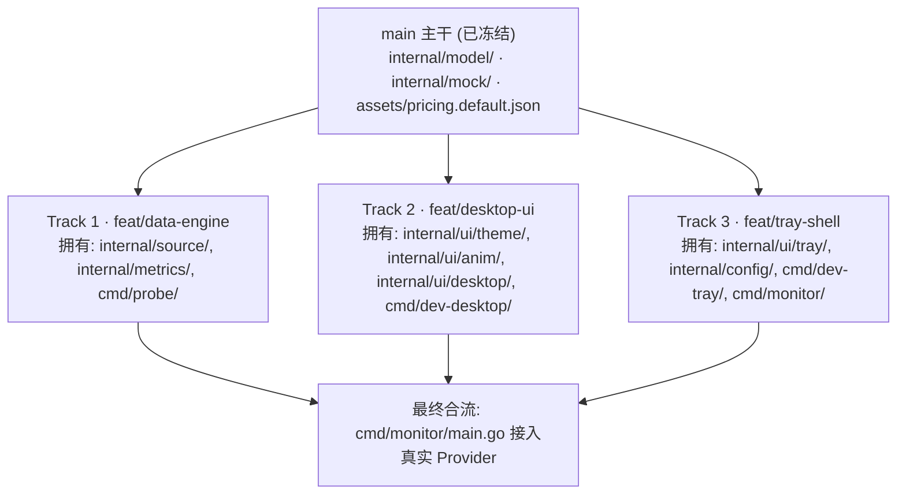

# Antigravity Monitor — 终版架构与 UI 设计方案（定稿）

> **定位**：零代理、零反代、零 WebView 的跨平台轻量级原生桌面统计面板。基于 **Go 1.27 + `github.com/egoist/mygo` (`v0.10.0`) Native UI（Direct3D 11 / Metal / OpenGL GPU 直绘）+ `plugins/glass`（Apple Liquid Glass）+ `ui/chart`**，直接只读解析 Antigravity 本地落盘数据，提供极简干净、60fps 丝滑、内存低至 18–35 MB 的原生应用体验。

---

## 1. 已定稿的产品核心决策

1. **双形态原生应用**：同时提供 **Pulse 风格托盘毛玻璃弹层（Tray Flyout）** 与 **完整桌面 APP 窗口（macOS Liquid Glass 极简风）**，底部一键互通，关闭主窗可退守托盘极低功耗驻留。
2. **纯吐字速度（Pure Decode TPS）唯一口径**：$\text{TPS} = T_{\text{out}} / \max(D_{\text{total}} - \text{TTFT},\ 0.05\text{s})$，设置面板中不保留冗余切换开关。
3. **父子 Agent 可视化树 + 无歧义口径**：
   - 左侧内嵌悬浮毛玻璃侧栏展示当前对话的「整棵会话树（合并） + 主 Agent + 各 Subagent 节点」，SVG 曲线连线带活跃光点流动画；
   - **整棵会话树视图**：
     - 上下文窗口卡右上角显示 **全树最高水位 + 所属节点名**（下方各节点独立进度条并排呈现，点击任意条可直达该节点）；
     - 费用卡展示 **全树本轮 / 全树会话总计**（标题区常驻 `合计 / 主 / 子` 三方单色对照）；
     - 缓存命中 / TTFT / 吐字速度三卡大字展示 **全树加权汇总**，次行展示 **最新单次 + 来源节点名**（如 `最新 94.2% · browser`）。
   - **单节点视图（点击主或任意子 Agent）**：
     - 上下文窗口右上角展示该节点自身的 `%` 与 `已用 / 上限`；
     - 缓存命中 / TTFT / 吐字速度三卡大字展示 **该节点最新单次**，次行展示 **该节点总计 / 均值 / 均速**。
4. **逐次请求的高可见度与克制排版**：
   - 桌面端底部卡片内置 `曲线 | 逐次` 胶囊切换：
     - **曲线态（默认）**：点击上方 4 张指标卡任意一张触发 60fps 曲线形变；鼠标滑过曲线带弹簧跟随竖线，下方常驻极简「单次请求检视栏」（`#id 节点 · 命中% · TTFT · TPS · 费用 · Token 构成` + `‹ ›` 逐条回看）；
     - **逐次态**：留白式极简请求列表，点击任意一行弹簧展开该次请求的 Token 构成进度条与模型名。
   - 托盘弹层点阵图支持鼠标悬停列实时直读该次请求的 `命中% · TTFT · TPS`。
5. **多对话并行支持**：
   - 侧栏顶部与托盘右上角提供极简玻璃会话切换器；多对话并行时显示克制的 `● N 进行中` 呼吸提示（单对话时隐藏）；
   - 支持 **自动跟随活跃对话（Auto-Follow）** 与 **手动点击锁定（Pin）**，后台其他对话更新时仅轻脉动提示、绝不抢夺焦点。
6. **Apple Liquid Glass 极简美学规范**（严格参照 `docs/prototype.html`）：
   - **零花哨色彩 / 去 AI 味**：全套单色极细 SF 风格线性图标 + 苹果中性灰阶排版，禁用彩色方块字标与堆叠胶囊；全局仅保留单一 Apple Blue 强调色（与极克制的 Amber 次通道/预警色）；
   - **真毛玻璃质感**：窗口级 `Vibrancy` + `plugins/glass`（`glass.Regular` / `glass.Clear`）+ 独立悬浮侧栏 + 顶部 1px 镜面高光边；
   - **60fps 丝滑动效**：阻尼弹簧数值滚动、弹簧胶囊滑块、曲线帧间形变插值、点阵图平滑过渡、树连线光点流、托盘弹簧弹出。

---

## 2. 本地只读数据引擎设计（零代理 / 零反代）

经本机 `~/.gemini/antigravity/` 实测验证，采用三层只读增量架构（纯 Go `modernc.org/sqlite` + `protowire`，Zero CGO）：

| 层级 | 文件路径 | 打开方式 | 关键字段与职责 |
| :--- | :--- | :--- | :--- |
| **L1 全局会话索引** | `conversation_summaries.db` | SQLite WAL `?mode=ro&_query_only=1` | 顶层会话发现、`not_fully_idle` 活跃判定、`parent_conversation_id` 父子树构建、`agent_name`、`workspace_uris`、`last_user_input_step_index` |
| **L2 会话高精度遥测** | `conversations/<conv_id>.db` | SQLite WAL 只读 + `WHERE idx > lastIdx` | 解析 `gen_metadata.data` Protobuf：`f1.f4.f2` (`input_tokens`)、`f1.f4.f5` (`cache_read_tokens`)、`f1.f4.f4` (`cache_creation_tokens`，多模型校准)、`f1.f4.f3` (`output_tokens` = `f9 + f10`)、`f1.f9.f10.f1/f4` (上下文占用/上限)、`f1.f11` (纳秒级 TTFT)、`f1.f12` (纳秒级总耗时)、`f1.f19/f21/f20` (模型与 `last_step_index`) |
| **L3 明文对齐与命名** | `brain/<conv_id>/.system_generated/logs/transcript.jsonl` | 按字节偏移增量 tail | 1) 精确 `USER_INPUT` 轮次边界；2) 从父对话 `invoke_subagent` 提取 `Role` 名称；3) L2 字段变化时的平滑降级兜底 |

### Subagent 三级命名策略
1. 优先从父对话 `transcript.jsonl` 中匹配 `invoke_subagent` 工具调用的 `Role` 参数（模型赋予的语义名，如 `Codebase Researcher`）；
2. 其次取 `conversation_summaries.agent_name`（如 `browser`、`research` 或 Swarm worker 名）；
3. 若同一父对话存在多个同名子 Agent，按创建时间自动编号为 `<name> #1`、`<name> #2`。

---

## 3. 三线并行开发架构（接口冻结 + 零文件冲突）

为了支持 3 个并行对话同时推进 Phase 1–3 且合并零冲突，主干 `main` 预先冻结了共享契约包 `internal/model/` 与仿真数据源 `internal/mock/`：

### 严格目录所有权矩阵

| 轨道 | 分支名 | 独占目录（仅编辑这些路径） | 独立运行与验证方式 |
| :--- | :--- | :--- | :--- |
| **Track 1 · 数据引擎** | `feat/data-engine` | `internal/source/`、`internal/metrics/`、`cmd/probe/`、`assets/pricing.default.json` | `go test ./internal/source/... ./internal/metrics/...` + `go run ./cmd/probe` 直读本机真实数据核验精度 |
| **Track 2 · 桌面端 UI** | `feat/desktop-ui` | `internal/ui/theme/`、`internal/ui/anim/`、`internal/ui/desktop/`、`cmd/dev-desktop/` | `go run ./cmd/dev-desktop` 直连 `internal/mock` 独立调试毛玻璃桌面窗、父子树与 60fps 曲线 |
| **Track 3 · 托盘与壳层** | `feat/tray-shell` | `internal/ui/tray/`、`internal/config/`、`cmd/dev-tray/`、`cmd/monitor/` | `go run ./cmd/dev-tray` 独立调试 Pulse 风格托盘弹层、点阵图与配置持久化；并在 `cmd/monitor` 预留合流入口 |

> [!IMPORTANT]
> **冻结契约规则**：并行开发期间，三条轨道**均不得修改 `internal/model/` 与 `internal/mock/`**；如确需新增字段，统一在合流前由主干评审合并。

---

## 4. 性能与资源目标预算

| 指标 | 目标值 | 保障措施 |
| :--- | :--- | :--- |
| **常驻内存（RSS）** | **18 – 35 MB** | 纯 Go + `mygo` GPU 直绘，零 WebView；活跃对话 LRU 池（最多常驻 5 个只读 DB 句柄） |
| **静息 CPU / GPU** | **< 0.2% CPU / ~0% GPU** | `fsnotify` 事件驱动 + 无活跃动画暂停帧渲染 + 隐藏至托盘降频休眠 |
| **活跃刷新延迟** | **< 250 ms** | 按 `conv_id` 独立 `150ms` 防抖 + 增量 `WHERE idx > ?` + `< 0.1ms` `protowire` 解析 |
| **冷启动速度** | **< 200 ms** | 单体原生二进制，按需懒加载历史对话 |
